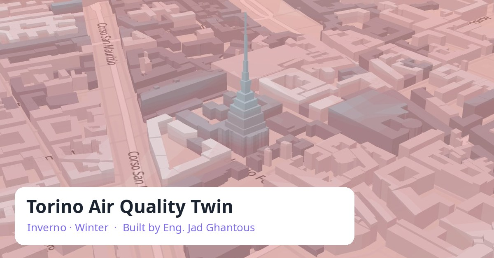

# Torino Air Quality Twin · Inverno

**Built by Eng. Jad Ghantous**

### ▶ [Open the live 3D viewer](https://jadghant.github.io/torino-air-quality-twin/)

Turin's winter air in 3D: nitrogen dioxide and fine particles on a 100 m grid, the winter inversion lid and the
Mole Antonelliana, for selected days of winters 2024–25 and 2025–26. Works on desktop and phones.

## Data sources

- Air-quality stations: European Environment Agency (EEA)
- Regional air quality (CAMS), weather (ERA5) and terrain (DEM): Copernicus, via Open-Meteo.com
- Buildings: © OpenStreetMap contributors (ODbL)
- Emissions (EDGAR) and population and building height (GHSL): European Commission, Joint Research Centre
- Maps: MapLibre GL JS, OpenFreeMap (© OpenMapTiles), Terrain Tiles on AWS (Mapzen)

Licences and required attributions: [sources page](https://jadghant.github.io/torino-air-quality-twin/sources.html). Not for regulatory use.

© 2026 Eng. Jad Ghantous. Code and logo: all rights reserved; data under their own licences (see [LICENSE](LICENSE)).
