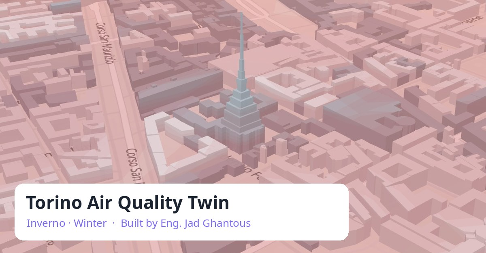

# Torino Air Quality Twin · Inverno

**Built by Eng. Jad Ghantous**

### ▶ [Open the live 3D viewer](https://jadghant.github.io/torino-air-quality-twin/)

Works in any modern browser, on desktop and on phones. No installation, no sign-in.

## What it is

A 3D digital twin of Turin's winter air. Every winter the Po Valley traps the city's air under a lid of warm air, often
lower than the 167 m Mole Antonelliana. The twin rebuilds that air on a 100 m grid, for nitrogen dioxide (NO₂) and fine
particles (PM10, PM2.5), from public data, and draws it in 3D over the city: the buildings, the terrain, the lid and
the air beneath it.

## What you can do in this viewer

- Switch between **winters 2024–25 and 2025–26** and between **NO₂, PM10 and PM2.5**.
- Step through **selected days**, chosen by the twin from the data: the worst PM10 day, the deepest inversion, the
  cleanest day and a typical day (daily means). Press ▶ to play them.
- Rotate and tilt the 3D view (drag; two fingers on a phone), and see the lid against the Mole in the side panel.
- Turn layers on and off: buildings, the 3D air, a ground map, reference stations, schools and hospitals.

This public edition is a taste of the twin. The full twin, its model, validation and forecasts are not published here.

## Data

Built only from public data: European Environment Agency air-quality stations; Copernicus CAMS, ERA5 and DEM via
Open-Meteo.com; © OpenStreetMap contributors; EDGAR and GHSL (European Commission, JRC). Maps by MapLibre GL JS,
OpenFreeMap (© OpenMapTiles) and Terrain Tiles on AWS (Mapzen). Every licence and required attribution:
[sources.html](sources.html).

Not for regulatory use. January–February 2026 measurements are preliminary.

## Author

**Eng. Jad Ghantous**, environmental engineer. Designed, built and validated the Torino Air Quality Twin.

## Licence

© 2026 Eng. Jad Ghantous. The viewer code and logo are all rights reserved (see [LICENSE](LICENSE)). The data files
keep their own licences: OpenStreetMap-derived files under ODbL 1.0, the others as listed on the sources page.
